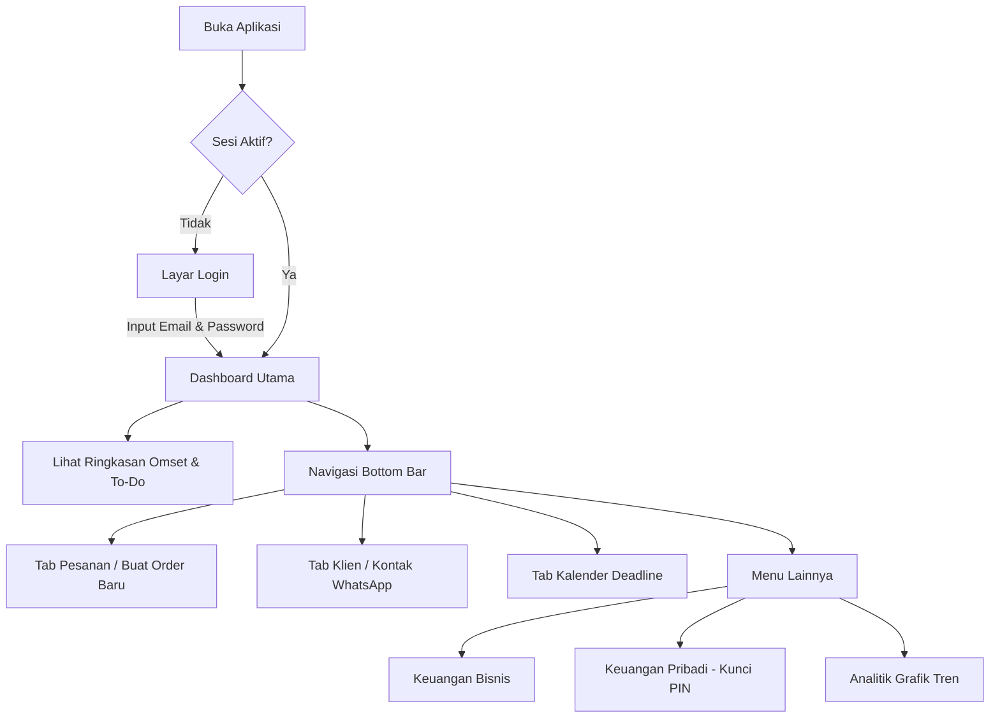

# WolfyCreativ Mobile 🐺🎨
### Sistem Manajemen Agensi Kreatif & Pencatatan Finansial Multi-Modul
> **Tugas Ujian Tengah Semester (UTS) Ganjil Tahun Akademik 2026/2027**  
> **Mata Kuliah:** Mobile Testing (TI23B)  
> **Dosen Pengampu:** Triyono M.Kom  
> **Fakultas Ilmu Komputer, Universitas Duta Bangsa Surakarta**  

---

## 📋 1. Identitas Pengembang & Proyek

* **Nama Mahasiswa:** IBNU KHAIRUL HUDA
* **NIM:** *230103227*
* **Kelas:** TI23B
* **Program Studi:** S1 Teknik Informatika
* **Repositori Git:** [https://github.com/ibnukhairul/wolfycreativapp](https://github.com/ibnukhairul/wolfycreativapp)
* **Tautan Video Penjelasan (5–10 Menit):** *[Isi Tautan YouTube / Google Drive Anda]*

---

## 🎯 2. Gambaran Umum Aplikasi

### A. Tujuan Aplikasi
**WolfyCreativ Mobile** dirancang untuk membantu pemilik studio desain, pekerja lepas (*freelancer*), dan agensi kreatif dalam mengorganisir alur kerja proyek secara terpadu. Aplikasi memadukan manajemen pesanan klien (*client order CRM*) dengan pemisahan pencatatan keuangan bisnis dan keuangan pribadi secara aman dan *real-time*.

### B. Target Pengguna
1. **Creative Director / Studio Owner:** Pengambil keputusan yang membutuhkan pemantauan metrik pendapatan, statistik pesanan, dan efisiensi tim.
2. **Project Manager:** Pengelola relasi klien, pembuat invoice, dan penanggung jawab batas waktu pengerjaan (*deadline*).
3. **Desainer Grafis / Freelancer:** Pelaksana teknis yang membutuhkan daftar tugas harian (*To Do List*) dan pelacak arus kas (*cashflow*) pribadi.

### C. Fitur Utama
* 📊 **Dashboard Analitik & Ringkasan Bisnis:** Menampilkan statistik pesanan aktif, total omset, daftar to-do harian, serta fitur *privacy toggle* untuk menyamarkan nominal omset.
* 📦 **Manajemen Pesanan (Orders CRM):** Siklus pembuatan pesanan baru, generator kode invoice otomatis, pengingat deadline, pelacak status (Baru, Proses, Selesai, Dibatalkan), dan status pembayaran.
* 👥 **Direktori Klien (Customers):** Pencatatan profil klien, kontak WhatsApp, riwayat order, dan integrasi pengiriman pesan invoice langsung ke WhatsApp.
* 🎨 **Katalog Layanan (Services):** Manajemen daftar paket jasa (Branding, Web Design, Social Media Management) beserta tarif dasar.
* 💼 **Keuangan Bisnis & Invoice Generator:** Laporan laba/rugi, pencatatan biaya operasional, dan generator teks tagihan otomatis.
* 🔐 **Keuangan Pribadi (Protected Cashflow):** Pencatatan pemasukan & pengeluaran harian pribadi yang dilindungi oleh sistem keamanan biometrik / PIN.
* 📅 **Kalender Tenggat Waktu:** Tampilan kalender interaktif yang menandai deadline proyek agar pengiriman hasil kerja selalu tepat waktu.

### D. Alur Pengguna (*User Flow*)


### E. Batasan Pengujian (*Testing Scope & Boundaries*)
1. **Platform Uji:** Pengujian difokuskan pada platform **Android** (arsitektur ARM64 / x86_64 emulator dan perangkat fisik Android 10+).
2. **Konektivitas:** Modul otentikasi dan sinkronisasi data bergantung pada koneksi internet aktif ke server BaaS Supabase.
3. **Pengujian Biometrik:** Pengujian biometrik fisik dieksekusi secara manual; pada automate testing Maestro, verifikasi difokuskan pada alur form transaksi, navigasi, dan validasi error.

---

## 🧪 3. Pengujian Aplikasi (UAT & Maestro Automation)

Sesuai ketentuan silabus UTS Mobile Testing, pengujian dilakukan dengan dua metode:

### A. User Acceptance Testing (UAT)
Dokumentasi lengkap UAT tersedia pada berkas [**`UAT_REPORT.md`**](./UAT_REPORT.md) dan lembar verifikasi matriks Excel [**`UAT_Testing_WolfyCreativ_Mobile.xlsx`**](./UAT_Testing_WolfyCreativ_Mobile.xlsx).
* Mencakup **7 skenario pengujian komprehensif** (Alur utama autentikasi, dashboard monitoring, alur transaksi/CRUD pembuatan order, validasi kesalahan input kosong, filtering pencarian, dan proteksi finansial pribadi).
* Hasil Pengujian: **100% LULUS (PASS)**.

### B. Automate Testing Menggunakan Maestro
Automasi pengujian dibangun menggunakan **Maestro** pada folder [**`.maestro/`**](./.maestro/), terdiri atas 4 flow wajib:
1. [**`01_app_launch.yaml`**](./.maestro/01_app_launch.yaml) — Pengujian pembukaan aplikasi, splash, dan assertion kesiapan elemen navigasi utama.
2. [**`02_navigation.yaml`**](./.maestro/02_navigation.yaml) — Pengujian transisi navigasi antar seluruh menu bottom navigation bar dan bottom sheet.
3. [**`03_transaction_crud.yaml`**](./.maestro/03_transaction_crud.yaml) — Pengujian alur transaksi/CRUD pembuatan order baru dan form validation.
4. [**`04_validation_error.yaml`**](./.maestro/04_validation_error.yaml) — Pengujian kondisi gagal (*negative testing*) saat submit form tanpa input customer.
5. [**`run_all.yaml`**](./.maestro/run_all.yaml) — Suite runner untuk mengeksekusi ke-4 alur pengujian secara berurutan.

Setiap berkas flow dilengkapi dengan:
* `assertVisible` pada elemen-elemen UI kritis.
* `takeScreenshot` untuk merekam bukti eksekusi visual ke direktori bukti screenshot.

---

## 🚀 4. Petunjuk Menjalankan Aplikasi & Pengujian

### Prasyarat Sistem
* Flutter SDK (versi `3.47.5` atau yang kompatibel)
* Android SDK (API Level 34 / 36) & Java JDK 17
* Maestro CLI / Maestro Studio
* Perangkat Android fisik dengan opsi *USB Debugging* aktif atau Android Emulator

### A. Menjalankan Aplikasi (Flutter)
```bash
# 1. Klon repositori
git clone https://github.com/ibnukhairul/wolfycreativapp.git
cd wolfycreativapp

# 2. Ambil seluruh dependensi pub
flutter pub get

# 3. Jalankan pada emulator atau perangkat terhubung
flutter run
```

### B. Membuat Berkas APK Siap Pasang
```bash
# Membuat build APK debug
flutter build apk --debug

# Lokasi output APK:
# build/app/outputs/flutter-apk/app-debug.apk
```

### C. Menjalankan Automate Testing Maestro

#### Menggunakan Maestro CLI (Terminal):
```bash
# Pastikan perangkat/emulator telah terhubung (adb devices)
adb devices

# 1. Menjalankan flow pembukaan aplikasi
maestro test .maestro/01_app_launch.yaml

# 2. Menjalankan flow navigasi
maestro test .maestro/02_navigation.yaml

# 3. Menjalankan flow transaksi / CRUD
maestro test .maestro/03_transaction_crud.yaml

# 4. Menjalankan flow validasi error
maestro test .maestro/04_validation_error.yaml

# Atau jalankan seluruh alur sekaligus:
maestro test .maestro/run_all.yaml
```

#### Menggunakan Maestro Studio (Visual GUI):
```bash
# Jalankan Maestro Studio via terminal atau buka aplikasi Maestro Studio desktop:
maestro studio
```
Buka browser pada alamat `http://localhost:9999` untuk melihat visualisasi elemen UI perangkat, melakukan inspeksi XPath/teks, dan mengeksekusi test flow secara interaktif.

---

## 🌳 5. Struktur Repositori & Praktik Git

Repositori ini dikelola menggunakan metodologi **Git Flow** dengan pembagian branch dan commit berkala:
* **`main`**: Branch stabil untuk versi rilis produksi (tertag `v1.0.0`).
* **`develop`**: Branch integrasi utama selama tahap perancangan & pengujian.
* **`feature/*`**: Cabang fitur spesifik (`feature/core-foundation`, `feature/auth`, `feature/dashboard`, `feature/orders`, `feature/testing-maestro-uat`, dll.).

Perintah untuk melihat grafik riwayat pengembangan:
```bash
git log --graph --oneline --all --decorate
```

---

## 🔒 6. Catatan Keamanan & Kredensial
Sesuai instruksi umum ujian (poin 3), repositori ini **tidak menyimpan kredensial sensitif, password database, atau service key admin**. Kunci anonim Supabase yang digunakan memiliki izin terbatas (*Row Level Security / RLS*) yang hanya mengizinkan akses sesuai otentikasi pengguna terverifikasi.
